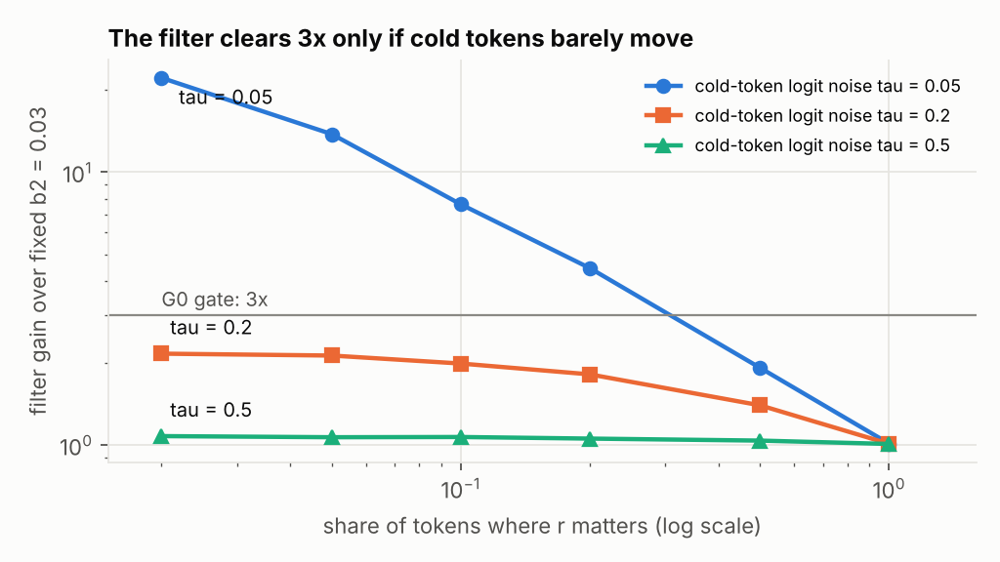
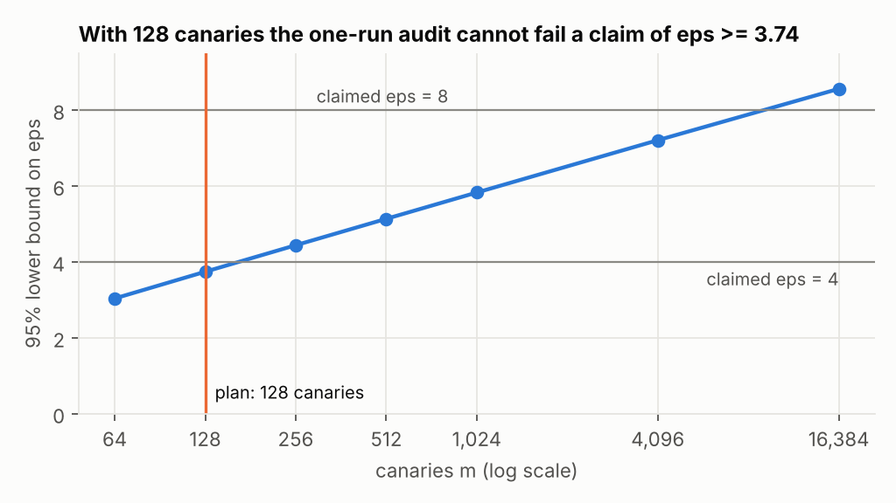
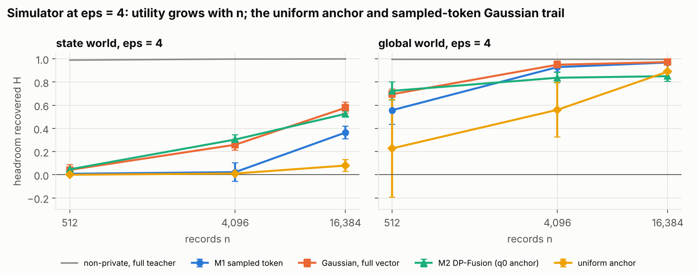
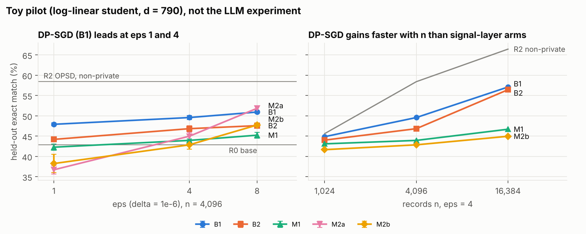

# Results: DP privileged-context distillation (31 Oct 2026)

Everything in the plan that runs without the LLM has been run: the Phase 0 accountant and budget table, the efficiency-estimate machinery, the Phase 3 filter witness and audit validation, the analytic simulator, and a toy CPU pilot of all ten arms. The LLM phases (G0 divergence profile and teacher headroom, Phase 1, Phase 2, the LLM audits) did not run. This environment has no GPU and cannot reach `huggingface.co`. **No gate (G0, G1, G2) has been decided.**

The zero-GPU work found five problems in the plan that should be fixed before GPU time is spent (Findings 1–5). Findings 6–9 are about the method. In the toy pilot, tuned DP-SGD beat every signal-layer arm at ε = 4, and the gap widened with n (Finding 9). That makes H3 the riskiest hypothesis.

## Findings that change the plan

1. **M1 is over-noised by 2×.** The plan accounts every arm under add/remove-r, where the neighbour's teacher is q0 and M1's release is clip(0) + noise. M1's sensitivity is therefore c, not 2c, so σ = c√R/μ. The plan's σ = 2c√R/μ is the replace-r value. As written, M1 runs at twice the noise std of every other arm, which halves its total SNR (E0).
2. **Plain B2 needs the replace-one accountant.** Under add/remove-r, x stays in the data, so removing r changes a record's clipped gradient from g_r to g_0 rather than to zero. Use the `REPLACE_ONE` relation; at the Phase 2 defaults it costs only about 1% more noise (z = 0.584 vs 0.579 at ε = 4). The alternative is clipping the residual g_r − g_0 with the anchor term sampled independently (E0).
3. **M2/M3 are RDP-accounted, so their budget is smaller than the table says.** Converting an RDP curve to (ε, 1e-6) gives μ = 0.788 at ε = 4 instead of the GDP value 0.838, so token caps fall by about 11% (62 instead of 70 at b₂ = 0.01). Tracking only order 2, as a DP-Fusion-style bound would, can never certify ε below 12.4 at δ = 1e-6. The order that matters is about 7 at ε = 4, 22 at ε = 1 and 4 at ε = 8 (E0).
4. **The Phase 3 audits cannot fail at ε = 4 or 8.** With 128 canaries, even a perfect attacker cannot certify ε above 3.74. The plan's "leak demonstration" (M1 with private token selection) leaks blatantly. At a claimed ε = 4 it still passes the audit with 128 and 1,024 canaries, and is caught only with 8,192 (E3). Run the leak demonstration at a claimed ε = 1, where 128 canaries suffice. An audit at ε = 4 needs at least 166 canaries before even a perfect attacker could fail it, and our realistic leak needed 8,192. Treat ε = 4 and 8 audits as checks against gross failures only.
5. **The student must not see the mixing weight λ.** In M2/M3, λ is computed from the private teacher q, so a student loss that uses the per-token λ leaks r. Our first simulator version did this. The student may use only a public λ̂, for example the mean λ on the public proxy split. That misspecification leaves a bias floor: in the fully shared simulator world M2 levels off near H = 0.85 while the Gaussian arms reach 0.97 (E4).

## Findings about the method

6. **The filter's gain is set by the cold-token floor.** The gain of realized-divergence accounting over a fixed b₂ is b₂ / E[min(D_t, b₂)]. It clears the 3× gate only when most tokens carry divergence well below b₂, roughly a median μ_t² under b₂/10, with under about 20% hot tokens. If putting r in context perturbs every token a little, the gain disappears (E1). Record-specific divergence also uses up the filter's budget (simulator: the filter gains 2.5× in utility at τ = 0 and nothing at τ = 0.5, E4). The first thing to measure in G0 is the median per-token divergence on Qwen3 rollouts.
7. **The filter is valid, and the checks catch real bugs.** Across 72 toy LMs, the exact Rényi divergence of the whole filtered run never exceeds its budget; the maximum ratio is exactly 1.000. A last-token overspend control violated the budget in 57/72 runs and a wrong-order control in 72/72 (E2). Our own pilot had a parallel-rollout overspend bug (ledger at 1.22× budget), which the ledger assertion caught and we fixed (E5).
8. **Direction ④'s conjecture is not supported.** In the simulator, DP widens the gap between sampled-token and full-distribution feedback rather than collapsing it. The gap is 0.12 headroom non-privately and 0.24 at ε = 4 (state world, n = 4,096) (E4). One caveat: the simulator's vocabulary has 32 tokens, and a full-vector Gaussian release over a 150k vocabulary would not be practical.
9. **In the toy pilot, DP-SGD wins and pulls further ahead as n grows.** At ε = 4 the best signal-layer arm trailed B1 (DP-SFT) by 4.6 points (paired difference −4.6, 95% CI [−6.2, −3.0]). B1's lead over M1, M2b and M3 grew from 1.8 to 10.4 points as n went from 1,024 to 16,384. Per-record releases carry independent noise, so their SNR grows as √n, while DP-SGD aggregates before adding noise. H3 therefore depends on DP-SGD's effective dimension for LoRA on Qwen3 being large relative to n. Run B1 against the best M arm at n = 4,096 early in Phase 2 (the plan's "DP-SGD dominates" early signal), before committing to the full 90-run grid (E5).

## Status by plan item

| Plan item | Status | Where |
|---|---|---|
| Phase 0: accountant tests | Done; 20 unit tests pass | `tests/`, E0 |
| Phase 0: budget table | Reproduced exactly; RDP-accounted version added | E0 |
| Phase 0: divergence profile on Qwen3 rollouts | Blocked (model access, GPU) | estimator ready: `dpcd/efficiency.py` |
| Phase 0: efficiency estimate | Machinery done, run on synthetic profiles only | E1 |
| Phase 0: teacher headroom | Blocked (model access, GPU) | |
| Phase 1: headroom, shared component, leakage | Toy pilot only: +15.5 headroom, half-split keeps 64–71%, no leakage measurable in the toy | E5 |
| Phase 2: main DP grid | Toy pilot only: best M arm − best B arm = −4.6 points at ε = 4 | E5 |
| Phase 3: filter witness | Done (exact enumeration) | E2 |
| Phase 3: one-run canary audit | Validated; ceiling and power measured | E3, E5 |
| Phase 3: selection swap | Done in the pilot: 0 changes for M2b/M3 chunk selection | E5 |
| Phase 3: leak demonstration | Done in simulation; only caught with enough canaries | E3 |
| Ablations: predictions | Tested in the simulator; on-policy vs off-policy tested in the toy pilot | E4, E5 |
| Direction ④: reverse-KL limits under DP | Tested in the simulator | E4 |

## E0: budget table and accounting checks

Reproduces every number in the feasibility note and the plan (δ = 1e-6). Full tables: [results/e0_budget/tables.md](results/e0_budget/tables.md).

| ε | μ, GDP (M1) | μ via RDP (M2/M3) | RDP order | Total SNR, n = 4,096 | Total SNR, n = 16,384 | Tokens at b₂ = 0.01, GDP / RDP | Tokens at b₂ = 0.1, GDP / RDP |
|---|---|---|---|---|---|---|---|
| 1 | 0.237 | 0.221 | 22 | 7.6 | 15.1 | 5.6 / 4.9 | 0.56 / 0.49 |
| 2 | 0.448 | 0.420 | 12 | 14.3 | 28.7 | 20.1 / 17.6 | 2.01 / 1.76 |
| 4 | 0.838 | 0.788 | 7 | 26.8 | 53.6 | 70.2 / 62.2 | 7.02 / 6.22 |
| 8 | 1.532 | 1.450 | 4 | 49.0 | 98.0 | 234.6 / 210.4 | 23.46 / 21.04 |

Total SNR is the plan's replace-r value; under add/remove-r it doubles (Finding 1). At the Phase 2 defaults (n = 16,384, 300 updates of 64, 4 rollouts) M1 needs σ/c = 41.3 (plan) or 20.7 (add/remove) at ε = 4 with 64 released tokens per rollout. The per-step SNR does not depend on how many tokens are released: 3.10, or 6.19 under add/remove. DP-SGD at the same defaults needs z = 0.579 (add/remove) or 0.584 (replace-one) at ε = 4.

## E1: efficiency estimate (synthetic profiles)

The real G0 numbers need Qwen3 rollouts. This run maps out the decision rule in advance on LLM-like synthetic profiles: V = 512, peaked q0 with median top-1 probability 0.88, a share f of "hot" tokens where r moves mass to a token q0 ranks 2–50, and cold tokens whose logits move by N(0, τ²).

| cold-token noise τ | hot share f | median μ_t² | gain at b₂ = 0.01 | gain at b₂ = 0.03 | gain at b₂ = 0.1 |
|---|---|---|---|---|---|
| 0.05 | 0.02 | 0.0004 | 10.3 | 22.2 | 37.9 |
| 0.05 | 0.2 | 0.0006 | 3.8 | 4.4 | 4.8 |
| 0.05 | 0.5 | 0.086 | 1.8 | 1.9 | 2.0 |
| 0.2 | 0.02 | 0.011 | 1.4 | 2.2 | 5.2 |
| 0.2 | 0.2 | 0.016 | 1.3 | 1.8 | 3.0 |
| 0.5 | any | ≥ 0.13 | 1.0–1.3 | 1.0–1.1 | 1.1–1.3 |

The gain does not depend on ε. The clipped Gaussian uses only 0–14% of its budget on these profiles, because the student mostly samples tokens where the log-ratio is small. Full table: [results/e1_efficiency/tables.md](results/e1_efficiency/tables.md).

## E2: filter witness

Every output sequence of a filtered sampler on random toy LMs was enumerated (V = 3, T = 8 and V = 4, T = 7; up to 16,384 outputs each), and the exact Rényi divergence of the whole run was computed against the add/remove-r neighbour in both directions. Settings: order α = 7, per-record budget B = 0.6, per-token cap 0.25, claimed ε = 2.42.

| Policy | Runs | Runs exceeding B | Max D_α / B | Max exact δ at the claimed ε |
|---|---|---|---|---|
| M3 filter | 72 | 0 | 1.000 | 0 |
| M2 fixed b | 72 | 0 | 0.833 | 0 |
| control: last token overspends | 72 | 57 | 1.250 | 0 |
| control: wrong Rényi order | 72 | 72 | 5.433 | 4.9e-3 |
| one-sided filter | 72 | 0 | 1.000 | 0 |

The backward direction D_α(P0 ‖ P) never exceeded 0.53× the forward one. The two-sided charge in the plan is safe, and in practice equals the forward charge. The overspend control breaks the RDP budget but not the (ε, δ) claim, because RDP conversion has slack. The witness therefore has to test the RDP ledger, as here, not only δ.

## E3: one-run audit

**Validity.** On canaries whose inclusion goes through an exact (ε, 1e-6)-DP Gaussian mechanism, the 95% lower bound never exceeded the true ε (20 trials per cell). Its maximum was 3.44 at true ε = 8 with 8,192 canaries.

**Leak demonstration.** M1 releases 8 of 64 tokens per record; a canary's r puts a large log-ratio at a secret position.

| Claimed ε | Selection | 128 canaries | 1,024 canaries | 8,192 canaries |
|---|---|---|---|---|
| 1 | public | passes (0.00) | passes (0.04) | passes (0.00) |
| 1 | private (DIAL-style) | **fails** (1.79) | **fails** (3.66) | **fails** (5.40) |
| 4 | public | passes (0.00) | passes (0.00) | passes (0.05) |
| 4 | private (DIAL-style) | passes (1.80) | passes (3.66) | **fails** (5.40) |

The numbers in brackets are mean 95% lower bounds over 5 trials. The δ term follows the p-value routine of Steinke et al. (2023), and the scan over the number of guesses is Bonferroni-corrected.

## E4: analytic simulator

A categorical world: 64 public states, 32 tokens, a shared privileged shift Δ, and record-specific logit noise τ = 0.5. Each record releases 16 private tokens. The student is a log-linear tilt of q0, fitted by penalised maximum likelihood to whatever each mechanism releases. Every mechanism's knobs are tuned on a separate proxy world. H is the share of headroom recovered: 1 means the population teacher, 0 means q0. Full tables: [results/e4_simulator/tables.md](results/e4_simulator/tables.md).

Pre-registered ablation predictions (ε = 4, n = 4,096 unless stated; H mean over 3 seeds, sd ≈ 0.02–0.08):

| Prediction (plan) | Simulator result | Verdict |
|---|---|---|
| Sparse vs dense M1 release: no difference | k = 4 / 16 / 64 of 64 tokens: 0.95 / 0.92 / 0.93 (global), 0.13 / 0.11 / 0.13 (state) | Supported |
| Few strong vs many weak M2 tokens: equal to first order | 4 / 16 / 64 tokens: 0.84 / 0.82 / 0.85 (global), 0.31 / 0.29 / 0.36 (state) | Supported |
| Uniform anchor collapses | state world: 0.01 vs 0.30 for q0. Global world at n = 16,384: uniform 0.89 beats q0's 0.85 | Supported except for a fully shared signal at large n, where the uniform anchor's public λ avoids M2's bias floor |
| Best clip c near the typical log-ratio | tuned c = 1, clipping 7–11% of log-ratios | Supported |
| Gap to non-private shrinks as 1/√n (n × 4 predicts 0.5×) | Gaussian arms 0.41–0.65×; M2 0.68× (state) and 0.91–1.01× (global) | Supported for the Gaussian; M2 is limited by the λ̂ bias floor |
| Gaussian and DP-Fusion carry the same information per unit budget | state world: M2 0.30 vs sampled-token Gaussian 0.02, but full-vector Gaussian 0.26 | Equivalent per realized distinguishability; the sampled-token Gaussian wastes budget on small log-ratios |

The realized-divergence filter (M3) matched M2 at ε = 1 and 4, where tuning picked a cap equal to the fixed bound. At ε = 8 it beat M2 (state world: 0.68 vs 0.52 at n = 4,096; 0.86 vs 0.68 at n = 16,384).

## E5: toy CPU pilot of all ten arms

A synthetic stand-in for Phases 1–3, so the arms, accounting, schedules and audits could be exercised end to end on CPU. **It is not the LLM experiment, and its numbers say nothing directly about Qwen3.**

Setup: the student is a log-linear autoregressive policy with d = 790 parameters, answering 4-token problems over 10 symbols. The base model reaches 42.9% exact match. The teacher is the frozen base with a logit boost of 3 toward the private worked solution r, and 25% of r's tokens are record-specific noise. There are n = 4,096 records plus 256 canaries, 2 epochs of 64 problems per update, and 4 rollouts. Each arm got 6 configurations at ε = 4 on a separate proxy task, extended until the best was interior. M2/M3 use a public λ̂ measured on the proxy at each ε. Full tables: [results/e5_pilot/tables.md](results/e5_pilot/tables.md).

Held-out exact match (%), mean ± sd over training seeds (5 at ε = 4, 3 otherwise):

| Arm | ε = 1 | ε = 4 | ε = 8 | Non-private |
|---|---|---|---|---|
| R0 base | | | | 42.9 |
| R1 SFT | | | | 56.7 ± 0.4 |
| R2 OPSD | | | | 58.4 ± 0.8 |
| R3 privileged-sample imitation | | | | 57.1 ± 1.3 |
| B1 DP-SFT | 47.9 ± 0.4 | 49.6 ± 0.5 | 50.9 ± 0.3 | |
| B2 DP-OPSD (replace-one accounting) | 44.2 ± 0.2 | 46.8 ± 0.7 | 47.6 ± 0.6 | |
| M1 Gaussian log-ratio | 42.3 ± 0.8 | 43.9 ± 0.3 | 45.2 ± 0.7 | |
| M2a DP-Fusion synthetic SFT | 36.7 ± 1.0 | 45.0 ± 1.0 | 51.9 ± 0.5 | |
| M2b DP-Fusion on-policy chunks | 38.2 ± 2.3 | 42.9 ± 1.1 | 47.7 ± 0.5 | |
| M3 filtered chunks | 38.5 ± 1.9 | 43.2 ± 1.7 | 47.1 ± 0.4 | |

- **Toy primary endpoint fails.** At ε = 4 the best M arm (M2a) trails the best B arm (B1) by 4.6 points, paired 95% CI [−6.2, −3.0] over 5 seeds. At ε = 8, M2a edges B1 by 0.9 [−0.3, +2.2] (3 seeds). At ε = 1, M1 sits at base and the DP-Fusion arms fall 4–6 points below it, because λ̂ is only 0.04–0.10 and the learning rate was tuned at ε = 4.
- **The gap to DP-SGD grows with n.** At ε = 4, B1 leads the best of M1, M2b and M3 (the arms in the n sweep) by 1.8 points at n = 1,024, 5.7 at 4,096 and 10.4 at 16,384. This matches the accounting. Each record's releases carry their own noise, so the signal-layer SNR for a shared component grows only as √n, while DP-SGD adds noise once per aggregated step. Signal-layer release can only win if DP-SGD's effective dimension is large relative to n, which is exactly what Phase 2 has to measure.
- **Toy G1 passes.** Trained on half A, R2 gains 18.0 points on half-A problems and 12.7 on half-B problems (71%); R3 gains 19.0 and 12.1 (64%).
- **Off-policy beat on-policy.** M2a (off-policy synthetic SFT) beat M2b (on-policy chunks) at equal per-record budget: +2.1 [+0.2, +4.0] at ε = 4 and +4.1 [+2.9, +5.3] at ε = 8. M2a's budget went to 4 strong tokens per record, M2b's to 16 weak ones.
- **The filter bought nothing here.** M3 vs M2b: +0.4 [−0.7, +1.5] at ε = 4. The toy teacher shifts every token by the same amount, so there are no cold tokens to save on (Finding 6). The filter spent its budget exactly (ledger at 1.00).
- **Audits.**
  - The selection-swap audit found 0 changed selections for M2b and M3; a DIAL-style private selection changed the swapped record's pick, as it should.
  - The canary audit was uninformative in this toy. Even non-private SFT shows no leakage (lower bound 0, AUROC ≤ 0.55), because a 790-parameter log-linear student cannot memorise random canary answers. H4's leakage half needs the LLM.
- **The parameter-dimension sweep was inconclusive.** Adding irrelevant features (d = 10,390 and 82,070) also wiped out the non-private headroom: R2 fell to 42.2 and 41.9, around base. So every arm sat at base, and the sweep cannot separate noise geometry. The table is in the full results. A corrected sweep needs a model whose non-private headroom survives at large d.

Process notes: the first evaluation reused the ε = 4 λ̂ at ε = 1 and 8. Those runs are kept under `eval_superseded` in `e5.json`, and with the ε-matched λ̂ M2a at ε = 8 rose from 49.9 to 51.9. A parallel-rollout overspend in M3 was caught by the ledger check before any reported run (Finding 7).

## What the LLM run needs

- Network: allow `huggingface.co` in the environment's network settings to load Qwen3-1.7B and the math and MedMCQA data.
- Compute: GPUs for Phases 1–2. The plan's rough estimate is 500–800 H100-hours for Phase 2.
- Before the first GPU run, fix the plan per Findings 1–5: M1's σ, B2's accountant, RDP orders, canary counts, and public λ̂. The library code here already does all five.
- Run the G0 divergence profile first, with `dpcd/efficiency.py` on (q, q0, sampled-token) arrays from 500 records × 4 rollouts. The median per-token divergence settles the filter question immediately (Finding 6).
